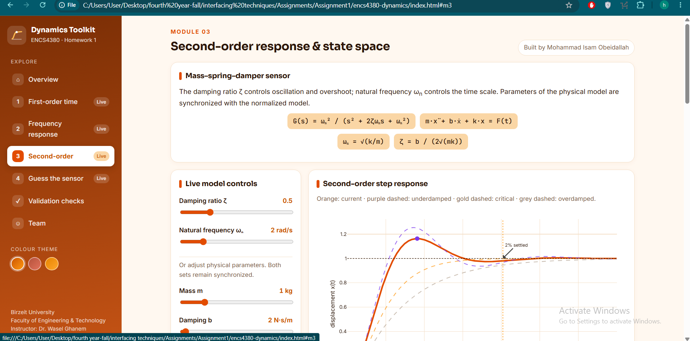
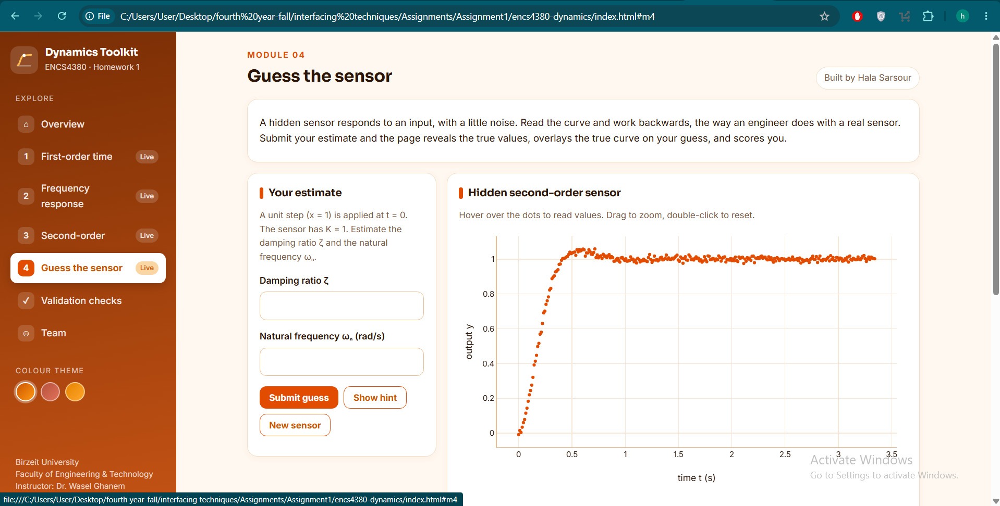

# encs4380-dynamics

# Dynamic Characteristics Toolkit — ENCS4380 Homework 1

Interactive web toolkit for sensor dynamic characteristics (ENCS4380 Interfacing Techniques, Birzeit University, Dr. Wasel Ghanem).

**Live page:** [https://<your-github-username>.github.io/encs4380-dynamics-<group-name>/](https://dalia-00.github.io/encs4380-dynamics/)

## Team

| Member | Module |
|---|---|
| Dalia Abu Baker| Module 1 — First-order time response; HW2 P2 — A slow sensor in the loop |
| Mohammad Obeidallah| Module 2 — First-order frequency response |
| Ghaleb Shakhsheer | HW1 Module 3 — Second-order response + state-space panel; HW2 P1 — PID playground |
| Hala Sarsour | Module 4 — "Guess the sensor" challenge |

## Module 1 — First-order time response (thermometer)

Model: τ·dy/dt + y = K·x(t), G(s) = K/(τs + 1)

- Sliders for K, τ, step size A (or ramp rate q̇) and initial reading y₀; Step / Ramp switch.
- Step plot with the 63.2 % point at t = τ and the 95 % point at t = 3τ, the ideal (instant) sensor, and the initial-slope line.
- Error-fraction plot on a log axis: ln eₘ = −t/τ, a straight line with slope −1/τ (τ is recovered from the slope).
- Ramp plot showing the steady-state time lag (= τ) and steady-state error (= q̇τ), plus the error-vs-time curve.
- "Predict, then check" box with random questions and a session score.
- Validation table (expected value, our value, PASS/FAIL), with values read off the plotted curve.

Closed-form responses used (from the lecture slides):
- Step: y(t) = KA + (y₀ − KA)·e^(−t/τ)
- Ramp: y(t) = K·q̇·(τ·e^(−t/τ) + t − τ)
## Screenshots

| Module 1 | Module 2 |
|---|---|
|  |  |

| Module 3 | Module 4 |
|---|---|
|  |  |

## Validation checks

| # | Check | Expected | Status |
|---|---|---|---|
| 1 | First-order step | y(τ) = 0.632 KA, y(3τ) = 0.95 KA | PASS (Module 1) |
| 2 | τ = 0.2 s, input sin 2t | M = 0.93, lag 21.8° | Module 2 |
| 3 | 100 Hz, ≤ 5 % dynamic error | τmax ≈ 0.52 ms, 9.3° at 50 Hz | Module 2 |
| 4 | ζ = 0.5 | overshoot 16.3 % | Module 3 |
| 5 | ζ = 1 | no overshoot | Module 3 |
| 6 | m = 1, b = 2, k = 4 | eigenvalues −1 ± j1.732 | Module 3 |
## Module 2 — First-order frequency response

Model: G(s) = K/(τs + 1), M = 1/√(1 + (ωτ)²), φ = −tan⁻¹(ωτ)

- Sliders for τ, input frequency ω, gain K and input amplitude A.
- Input, ideal output and sensor output sines on one plot.
- Live amplitude ratio M, phase lag, and cutoff frequency ω_c = 1/τ.
- Bode plot (magnitude and phase) with the cutoff marked and a dot that follows the selected ω.
- Dynamic-error calculator (δ = M − 1) and a button that applies the "100 Hz, at most 5% error" design limit.
- "Predict, then check" box and a validation table.

## Module 3 — Second-order response and state-space panel

Model: G(s) = Kωₙ² / (s² + 2ζωₙs + ωₙ²), with ωₙ = √(k/m) and ζ = b / (2√(mk))

- Sliders for ζ and ωₙ, or for m, b and k. The two sets stay synchronised.
- Underdamped, critically damped and overdamped step responses (preset buttons), with reference curves.
- Rise time, peak time, overshoot and settling time read live off the sampled curve.
- Poles plotted in the s-plane.
- State-space panel: A and B update live with m, b and k, the eigenvalues of A are shown next to the poles, and the (x₁, x₂) path is drawn in the phase plane.
- "Predict, then check" box and a validation table.

## Module 4 — "Guess the sensor"

- The page picks a hidden sensor at random: first order step (random K and τ), first order with a sine input (K = 1, random τ), or second order step (K = 1, random ζ and ωₙ). It adds noise to the response.
- You read the curve, estimate the parameters, and submit.
- The page reveals the true values, overlays the true curve (green) and your guess (red dashed) on the data, and scores the round.
- Scoring: within 10% error on a parameter is full marks, falling linearly to zero at 50% error. A round is worth 100 points, split across its parameters.
- Hints on request (one at a time), a "New sensor" button, and a running score for the session.
- The methods section on the page lists the equations needed: the 63.2% point and the log method for first order, and overshoot and peak time for second order.

## Tech

Static HTML + JavaScript, plots with [Plotly.js](https://plotly.com/javascript/). No server needed; works on phones.

<!-- add screenshots/module1-step.png and screenshots/module1-ramp.png -->

## AI use

An AI assistant (Claude) was used to help write the Module 1 page code and this README. All formulas were checked against the lecture slides and the validation numbers.

HW2 P2: Claude (Anthropic) was used to help write the P2 page (`p2.js`, `p2.css`, the P2 section of `index.html`) and its README entry. The Routh–Hurwitz threshold and the P-only damping formula come from the closed-loop characteristic equation and are checked by the validation table on the page.

---

## Homework 2 — Control

- **P1 — PID Playground (Ghaleb Shakhsheer):** [Open P1](https://dalia-00.github.io/encs4380-dynamics/#p1).
- Reuses HW1 Module 1 first-order model `G(s) = K/(τs+1)` and Module 3 normalized second-order model `G(s) = Kωₙ²/(s²+2ζωₙs+ωₙ²)`.
- Live plant selector, PID gains `Kp/Ki/Kd`, setpoint step, and symmetric actuator limit `±Umax` (normalized units).
- Differential-equation simulation with adaptive-step **forward Euler**; it does not use closed-form output curves.
- Plots of output versus setpoint, control signal and saturation limits, plus rise time (10–90%), overshoot, ±2% settling time and final simulated error.
- Uses **derivative on measurement** (`-Kd·dy/dt`) to prevent derivative kick from a setpoint step; conditional integral anti-windup prevents accumulation beyond actuator limits.
- Includes a “Predict, then check” exercise and numerical validation checks for P-only (`Kp = 9`) and PI (`Kp = 1, Ki = 1`, plus another PI setting).

**P1 source files:** `p1.js` (simulation, plots, metrics, validation), `p1.css` (styles), plus the new P1 page/navigation and script link in `index.html`.

**Note:** P1 uses normalized actuator commands. The real Micromouse motor model and the physical 0–100% PWM constraint belong in the team’s separate *My System* page. P2, P3 and P4 are separate teammate modules; they are not included in this P1 branch.

- **P2 — A slow sensor in the loop (Dalia Abu Baker):** [Open P2](https://dalia-00.github.io/encs4380-dynamics/#p2). Issue #7.
- A first-order sensor `1/(τs·s + 1)` sits in the feedback path. The controller only sees the sensor reading `ym`: `e = r − ym`, `u = Kp·e + Ki·∫e dt − Kd·dym/dt`.
- Same plants as P1 (HW1 Module 1 first order, Module 3 second order), sensor time constant `τs` slider, PID gains, setpoint, actuator limit and simulation time.
- **True output `y` and sensor reading `ym` on the same plot**, plus the control signal. A "Slow the sensor down" button animates `τs` from 0 to 3 s so the move to oscillation is visible.
- **Overshoot vs `τs` plot:** each point is a full simulation; the range where the loop no longer settles is shaded, with its edge from Routh–Hurwitz. For the first-order plant: `τ·τs·s³ + (τ + τs + K·Kd)s² + (1 + K·Kp)s + K·Ki = 0`, so the loop oscillates once `τs > (τ + K·Kd)(1 + K·Kp) / (τ·K·Ki − (1 + K·Kp))`.
- Live metrics: true overshoot, the overshoot the sensor reports, the hidden difference, true settling time, steady-state error, loop behaviour (settles / sustained / growing oscillation).
- Forward Euler simulation of plant, sensor and integral together (no closed-form curves). Derivative on the sensor reading, conditional-integration anti-windup.
- "Predict, then check" questions (final value, critical `τs`, true overshoot) and 5 validation checks computed by the simulator: `τs = 0` reproduces P1's `Kp = 9` case; a slow sensor does not change the steady state; with P only the sensor reading is a pure second-order response, so its overshoot matches `exp(−πζ/√(1−ζ²))` with `ζ = (τ + τs)/(2√(τ·τs(1 + K·Kp)))`; the true output overshoots more than the sensor shows; and for PI `Kp = 4, Ki = 8` the loop settles below and oscillates above `τs,crit = 5/3 s`.

**P2 source files:** `p2.js` (simulation, Routh analysis, plots, metrics, questions, validation), `p2.css` (styles scoped to `#p2`), plus the P2 page, menu link, home-page card and script link in `index.html`. P1's files are unchanged.

